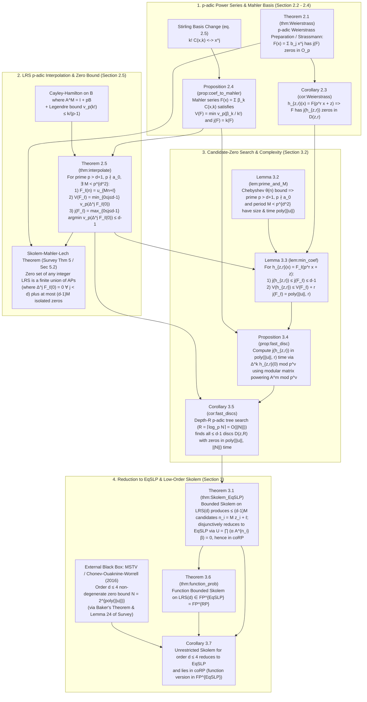

# Theorem-by-Theorem Dependency Graph: Low-Order Skolem & Survey (2026)

## Sources Downloaded Locally (in `papers/`)
1. **SODA 2026 Paper (`arXiv:2507.11234v3`)**: P. Bacik, J. Ouaknine, J. Worrell, *On the Complexity of the Skolem Problem at Low Orders*, SODA 2026.
   - Full LaTeX source: `papers/2507.11234/arxiv-corrected.tex` (715 lines)
   - PDF: `papers/skolem-complexity25.pdf`
2. **2026 Survey**: P. Bacik, T. Karimov, F. Luca, J. Nieuwveld, J. Ouaknine, D. Purser, J. Worrell, *A Survey of the Skolem and Positivity Problems for Linear Recurrence Sequences*, 2026 (59 pages).
   - PDF: `papers/skolem_and_positivity_survey26.pdf`
   - Extracted text: `papers/survey26.txt`

---

## 1. Complete Theorem Dependency Graph of `arXiv:2507.11234` (SODA 2026)

---

## 2. Detailed Breakdown of Each Result in `arXiv:2507.11234`

### Part I: $p$-adic Power Series, Mahler Series, and LRS Interpolation (Section 2)
1. **Theorem 2.1 (`thm:Weierstrass` — $p$-adic Weierstrass Preparation / Strassmann)**
   - **Statement:** Let $F(x) = \sum_{j=0}^\infty b_j x^j \in \mathbb{Z}_p[[x]]$ be a nonzero convergent power series ($v_p(b_j) \to \infty$). Let $V(F) = \min_j v_p(b_j)$ and $j(F) = \max \{ j_0 : v_p(b_{j_0}) = V(F) \}$. Then $F(x) = g(x) h(x)$ where $\deg g = j(F)$ and $h$ has no zeros in $\mathcal{O}_p$; in particular, $F$ has $j(F)$ zeros in $\mathcal{O}_p$ (and at most $j(F)$ zeros in $\mathbb{Z}_p$ by Strassmann's Theorem).
2. **Corollary 2.3 (`cor:Weierstrass`)**
   - **Statement:** Setting $h_{z,r}(x) = F(p^r x + z)$, $F$ has $j(h_{z,r})$ zeros in the disc $\overline{D}(z,r) = \{x \in \mathcal{O}_p : v_p(x - z) \ge r\}$.
3. **Proposition 2.4 (`prop:coef_to_mahler` — Equivalence of Power-Series and Mahler-Series Valuation Indices)**
   - **Statement:** If $F(x) = \sum_{j=0}^\infty b_j x^j = \sum_{k=0}^\infty \beta_k \binom{x}{k}$ with $v_p(\beta_k / k!) \to \infty$, then
     $$V(F) = \min_{k \ge 0} v_p(\beta_k / k!) \quad \text{and} \quad j(F) = \max \left\{ k \ge 0 : v_p(\beta_k / k!) = V(F) \right\}.$$
   - **Proof:** Uses the triangular change of basis via Stirling numbers of the first and second kind (which are integers, with diagonal entries $\pm 1$ and $1$) and the ultrametric inequality. **100% elementary and self-contained.**
4. **Theorem 2.5 (`thm:interpolate` — Mahler Interpolation of LRS & Finite-Difference Formula for $V(F_\ell), j(F_\ell)$)**
   - **Statement:** Let $\boldsymbol{u}$ be an order-$d$ integer LRS with companion matrix $A$ ($\det A = \pm a_0 \ne 0$) and $p > d+1$ a prime with $p \nmid a_0$. Then there exists $0 < M < p^{d^2}$ with $A^M = I + pB$ such that for each $\ell \in \{0, \dots, M-1\}$, the Mahler series $F_\ell(x) = \sum_{k=0}^\infty \beta_{\ell,k} \binom{x}{k}$ with $\beta_{\ell,k} = p^k x^\top B^k A^\ell y = (\Delta^k F_\ell)(0)$ satisfies:
     1. $F_\ell(n) = u_{Mn+\ell}$ for all $n \in \mathbb{N}$,
     2. $V(F_\ell) = \min_{0 \le j \le d-1} v_p((\Delta^j F_\ell)(0))$,
     3. $j(F_\ell) = \max \{ j \in \{0, \dots, d-1\} : v_p((\Delta^j F_\ell)(0)) = V(F_\ell) \} \le d-1$.
   - **Proof:** Uses Cayley–Hamilton on $B$ to show $\gamma_{\ell,k} = x^\top B^k A^\ell y$ satisfies an integer linear recurrence of order $d$, so $v_p(\gamma_{\ell,k}) \ge \min_{0 \le j < d} v_p(\gamma_{\ell,j})$ for all $k \ge 0$. Combined with Legendre's inequality $v_p(k!) \le \frac{k}{p-1}$ and $p > d+1$, this forces $v_p(\beta_{\ell,k}/k!) > \min_{0 \le j < d} v_p(\beta_{\ell,j})$ for all $k \ge d$. **100% elementary and self-contained.**

### Part II: Polynomial-Time Candidate Search and $\mathsf{EqSLP}$ Reduction (Section 3)
5. **Lemma 3.2 (`lem:prime_and_M`)**
   - **Statement:** There exists a prime $p > d+1$ with $p \nmid a_0$ and $p = \mathrm{poly}(\|\boldsymbol{u}\|)$, and $0 < M < p^{d^2}$ with $A^M \equiv I \pmod p$, computable in $\mathrm{poly}(\|\boldsymbol{u}\|)$ time (for fixed $d$).
6. **Lemma 3.3 (`lem:min_coef`)**
   - **Statement:** For any non-identically-zero subsequence $F_\ell$ and $h_{z,r}(x) = F_\ell(p^r x + z)$,
     1. $j(h_{z,r}) \le j(F_\ell) \le d-1$,
     2. $V(h_{z,r}) \le V(F_\ell) + r j(F_\ell) \le \log\left(\sum_{j=0}^{d-1} 2^d |u_{Mj+\ell}|\right) + r(d-1) = \mathrm{poly}(\|\boldsymbol{u}\|, r)$.
7. **Proposition 3.4 (`prop:fast_disc`)**
   - **Statement:** Choosing precision $\nu = V(F_\ell) + r d + 1 = \mathrm{poly}(\|\boldsymbol{u}\|, r)$, at least one of $(\Delta^0 h_{z,r})(0), \dots, (\Delta^{d-1} h_{z,r})(0)$ is nonzero modulo $p^\nu$, so $j(h_{z,r})$ can be computed deterministically in $\mathrm{poly}(\|\boldsymbol{u}\|, r)$ time via modular matrix exponentiation:
     $$(\Delta^k h_{z,r})(0) \equiv \sum_{n=0}^k (-1)^{k-n} \binom{k}{n} \alpha A^{M(p^r n + z) + \ell} \beta \pmod{p^\nu}.$$
8. **Corollary 3.5 (`cor:fast_discs`)**
   - **Statement:** For $R = \lceil \log_p N \rceil = O(\|N\|)$, the $p$-adic branch-and-bound procedure (`ZeroSearch`, Algorithm 1) maintains at most $d-1$ active discs $\overline{D}(z,r)$ at each depth $r \le R$ and outputs in deterministic $\mathrm{poly}(\|\boldsymbol{u}\|, \|N\|)$ time a candidate set $C_\ell \subseteq \{0, \dots, p^R - 1\}$ of size $|C_\ell| \le d-1$ containing all $z$ such that $0 \le Mz+\ell \le N$ and $u_{Mz+\ell} = 0$.
9. **Theorem 3.1 (`thm:Skolem_EqSLP`) & Theorem 3.6 (`thm:function_prob`)**
   - **Statement:** Across all $\ell \in \{0, \dots, M-1\}$, Algorithm 1 deterministically outputs in $\mathrm{poly}(\|\boldsymbol{u}\|, \|N\|)$ time:
     - All arithmetic progressions $(Mn + \ell)_{n \ge 0}$ on which $u_{Mn+\ell} \equiv 0$ (checked via $u_{Mn+\ell} = 0$ for $0 \le n < d$), and
     - At most $(d-1)M < (d-1)p^{d^2}$ candidate indices $n_1, \dots, n_m \in \{0, \dots, N\}$ outside those progressions.
     Testing whether each candidate $n_i = M z_i + \ell$ satisfies $u_{n_i} = \alpha A^{n_i} \beta = 0$ is an instance of $\mathsf{EqSLP}$.
10. **Corollary 3.7 (Unrestricted Order-$\le 4$ Skolem in $\mathsf{coRP}$)**
    - **Statement:** Combining Theorem 3.1 with the exponential upper bound $N = 2^{\mathrm{poly}(\|\boldsymbol{u}\|)}$ on the largest non-periodic zero of an order-$\le 4$ LRS (from MSTV + Bacik 2025 / Chonev–Ouaknine–Worrell 2016) reduces Order-$\le 4$ Skolem in deterministic polynomial time to at most $(d-1)M$ matrix-power zero tests $\alpha A^{n_i} \beta \stackrel{?}{=} 0$.

---

## 3. How to Structure This as Prove2Me Missions + Research Workbench

Because **Part I** and the deterministic candidate extraction in **Part II** do **not** require Baker's theorem at all, we have a natural, high-impact formalization roadmap:

### Mission Proposal A: *On the Complexity of the Skolem Problem at Low Orders* (`arXiv:2507.11234`)
- **Collection:** *The TCS Formalization Drive* (Fields: `Theoretical Computer Science`, `Number Theory`)
- **Self-Contained Core Milestones (No Baker needed):**
  1. **Proposition 2.4 (`prop:coef_to_mahler`)**: Stirling-number basis change between power series and Mahler series preserves minimal valuation $V(F)$ and degree $j(F)$.
  2. **Theorem 2.5 (`thm:interpolate`)**: Mahler interpolation of LRS subsequences $u_{Mn+\ell}$ for $p > d+1, p \nmid a_0$, proving via Cayley–Hamilton and Legendre's bound that $V(F_\ell)$ and $j(F_\ell) \le d-1$ are determined by the first $d$ finite differences $(\Delta^0 F_\ell)(0), \dots, (\Delta^{d-1} F_\ell)(0)$.
  3. **Skolem–Mahler–Lech for Integer LRS**: Combining Theorem 2.5 with Strassmann's theorem yields that $\{n \in \mathbb{N} : u_n = 0\}$ is the union of finitely many arithmetic progressions $Mn+\ell$ and at most $(d-1)M$ isolated zeros. *(Directly replaces the retired `skolem_conjecture` node on Prove2Me!)*
  4. **Lemma 3.3 & Proposition 3.4**: Precision bound $V(h_{z,r}) \le V(F_\ell) + r(d-1)$ and soundness of modular finite-difference evaluation $(\Delta^k h_{z,r})(0) \bmod p^\nu$.
  5. **Theorem 3.1 & Corollary 3.7**: Correctness of `ZeroSearch` (Algorithm 1) reducing Bounded Skolem (and Order-$\le 4$ Skolem under the explicit MSTV upper-bound hypothesis) to testing $\alpha A^{n_i} \beta = 0$ on at most $(d-1)M$ candidate indices $n_i$.

---

## 4. Key Insight for Our Derandomization Research (Deliverables 1–4 of `idea.txt`)

Inspecting Algorithm 1 in `arXiv:2507.11234` reveals something crucial about the candidate indices $n_i = M z_i + \ell$ passed to the final $\mathsf{EqSLP}$ zero-test:

> **The candidate indices $n_i$ are NOT arbitrary $O(\|N\|)$-bit integers!**
> Every candidate $n_i = M z_i + \ell$ that survives `ZeroSearch` to depth $R$ is the $p$-adic approximation mod $p^R$ of an actual $p$-adic root $x_0 \in \mathcal{O}_p$ of $F_\ell(x) = 0$.
> In particular, by construction of `ZeroSearch`, $n_i = M z_i + \ell$ already satisfies:
> $$u_{n_i} = F_\ell(z_i) = (\Delta^0 h_{z_i, R})(0) \equiv 0 \pmod{p^R}$$
> (assuming $x_0 \in \mathbb{Z}_p$, or more generally $v_p(u_{n_i})$ is governed by the Newton polygon of $F_\ell$ at $z_i$).

This gives us a very sharp starting point for **Deliverables 1 & 2** in `idea.txt`:
1. Implement **Algorithm 1 (`ZeroSearch`)** in Python (`src/skolem_algorithm.py`) and verify it on the paper's worked example ($u_{n+3} = 2u_{n+2} - 3u_{n+1} + u_n$, $u_0=-1, u_1=1, u_2=7$, $p=5, M=8, N=200$, which isolates candidates $u_4, u_{59}, u_{100}$).
2. Analyze the exact arithmetic structure of the surviving candidate checks $u_{n_i} = \alpha A^{n_i} \beta \stackrel{?}{=} 0$ for order $d \le 4$.
